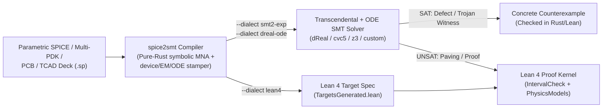

# Design Space: Below-RTL Analog, Multi-PDK Silicon & Anti-Sweep PCB Verification with Transcendental + ODE SMT and Lean 4

## 1. Beyond RTL Boolean Formal & Beyond Finite Corner Sweeps

Hardware verification conventionally bifurcates into two disconnected worlds:

1. **Above the RTL boundary (`SystemVerilog` / gate-level formal):** Signals are discrete Booleans in $\{0, 1\}$, time is quantized into synchronous clock ticks, and conservation laws (Kirchhoff's Current/Voltage Laws, Maxwell's transmission-line equations, Poisson/drift-diffusion electrostatics, and Joule self-heating) do not exist.
2. **Below the RTL boundary (`ngspice`, `Xyce`, `Spectre`, `DEVSIM`, SI/PI field solvers):** Continuous nonlinear physics is modeled with high fidelity, **but only via point simulation**—solving Newton–Raphson + BDF time-stepping from *one* initial guess at *one* parameter corner at a time.

Between those two worlds hide four classes of silicon and board-level failures that neither RTL formal verification nor $N$-corner Monte Carlo sweeps can rule out:

1. **Multi-Stable Analog Startup Trojans (`04a` vs `04b`):**
   Self-biased bandgap voltage references, current mirrors, and power-on-reset (POR) circuits solve $F_{\text{DC}}(x, p) = 0$. A conventional seeded DC solve can converge to the intended $1.20\text{ V}$ reference while missing another equilibrium. Yet over a sub-region of $(V_{DD}, T, \Delta E_{g,\text{Ge}})$, the exact same netlist possesses a **second DC equilibrium** near $v(\text{ref}) \approx 0\text{ V}$ where the PMOS mirror and heterojunction bipolar core starve each other of base/gate drive. Because an SMT solver searches the entire state-and-parameter box $[x_{\min}, x_{\max}] \times \mathcal{P}$ without seed bias, `.unsafe v(ref) < 0.15` expresses the low-current witness query in `04a` and the guarded safety query in `04b`. The Rust tests check both roots and use interval contraction to exclude unsafe guarded roots; a DC equilibrium check alone does not prove dynamical stability.
2. **Multi-Parameter PCB Manufacturing-Defect Resonances (`09a`–`12b`):**
   A single differential link with 8 continuous board-fabrication tolerances (copper etch undercut $\Delta w_{\text{etch}}$, gap etch $\Delta s$, prepreg thickness $\Delta h$, copper plating $t_{\text{cu}}$, +/- fiber-weave permittivity skew $(\varepsilon_{r,+}, \varepsilon_{r,-})$, via backdrill stub $\ell_{\text{stub}}$, return-plane slot inductance $L_{\text{slot}}$, and ceramic MLCC voltage derating) requires $5^8 = 390{,}625$ transient runs even at a coarse 5-point grid—and worst-case ringing/droop often occurs at interior or off-diagonal combinations where trace impedance $Z_0(\Delta w, \Delta h, \varepsilon_r)$ anti-resonates with $L_{\text{via}}(\ell_{\text{stub}})$ and nonlinear receiver ESD clamping. Symbolic `QF_NRA + exp + ODE` verification treats the entire manufacturing polytope $\mathcal{D}_{\text{fab}}$ as universally quantified real variables.
3. **Sub-10nm FinFET & 2nm GAA Nanosheet Quantum-Electro-Thermal Couplings (`02`–`03b`, `08`, `13`–`14b`):**
   In `asap7` (7nm FinFET) and `gt2n` (2nm Gate-All-Around stacked nanosheets), sub-nanometer fin or sheet thickness variation $\Delta T_{\text{body}}$ enters quadratically in the denominator of carrier subband energy $\Delta V_{\text{QM}} \propto (T_{\text{body}} + \Delta T_{\text{body}})^{-2}$ and inside exponential subthreshold/DIBL/self-heating loops.
4. **High-$dv/dt$ Nonlinear Capacitance Shoot-Through (`07`):**
   In wide-bandgap `gan_sic` half-bridges slewing at $50\text{ V/ns}$, displacement current through the voltage-dependent Miller capacitance $i_{gd} = \frac{d}{dt} Q_{gd}(v_{dg}) = C_{gd}(v_{dg}) \frac{dv_{dg}}{dt}$ lifts the off-state low-side gate toward $V_{\text{th}}$, threatening destructive cross-conduction.

---

## 2. Why Verify the Mathematical Physics Formulation (Not Simulator C++ Source)?

Verifying 500,000 lines of C/C++ inside `ngspice` or `DEVSIM` would only prove that floating-point Newton–Raphson executed IEEE-754 arithmetic as written—it would still evaluate **one point** from **one initial guess** with unverified truncation error.

Instead, `spice-smt-bench` separates responsibilities cleanly across three layers:

1. **The Physics Stamp Is the Formal Object:** Conservation laws (KCL/KVL, finite-volume Gauss's law, Scharfetter–Gummel flux continuity, Joule thermal balance) and smooth $C^\infty$ constitutive equations are stamped identically into SMT-LIB2 and Lean 4 (`TranscendentalField R`).
2. **Untrusted Nonlinear Search, Trusted Proof Kernel:** An SMT/ODE solver is free to use heuristics, $\delta$-weakening, interval Newton contractors, Taylor models, or SOS barriers to explore the state-and-parameter box; Lean 4 checks the supplied safety certificate or direct proof term. Only the explicitly named target theorems constitute Lean proofs.

---

## 3. Pure-`exp` Reduction & Singularity Elimination Choices

Transcendental SMT solvers perform dramatically better when queries use a **minimal, singularity-free operator basis** without `0 / 0` removable divisions or mixed `log`/`exp`/`sqrt` compositions:

1. **Pure-`exp` EKV / BSIM-CMG / ASM-HEMT Inversion Charge (`ln(1 + exp(z))` Elimination):**
   Rather than piecewise-regional `BSIM4` (`if Vgs < Vth ... else if Vds < Vdsat ...`), which shatters SMT search into $3^{N_{\text{mos}}}$ mode combinations with $C^1$ kinks, all MOSFETs and HEMTs use a smooth $C^\infty$ normalized inversion-charge core $y = \ln(1 + e^z)$. In `--dialect smt2-exp`, every occurrence of $y = \ln(1 + e^z)$ is lowered to a shared nonnegative auxiliary variable $y$ constrained by:
   $$\exp(y) = 1 + \exp(z)$$
   (`PhysicsModels.ekv_softplus_witness_nonneg` proves in Lean 4 that $y = \ln(1 + e^z)$ satisfies $\exp(y) = 1 + \exp(z)$ and $y \ge 0$).
2. **Algebraic Square-Root & Logarithm Lowering in PCB EM:**
   Hammerstad–Jensen microstrip and Bahl–Garg microstrip thickness-correction equations contain $\ln(\cdot)$ and $\sqrt{\cdot}$. Every $s = \ln(u)$ becomes $\exp(s) = u$, and every positive $r = \sqrt{w}$ becomes $r \ge 0 \land r^2 = w$.
3. **Cancellation-Free, Singularity-Free Scharfetter–Gummel Bernoulli Stamp:**
   Classical TCAD writes $B(\Delta) = \frac{\Delta}{e^\Delta - 1}$ and $B(-\Delta) = B(\Delta) + \Delta$, which suffers both a `0 / 0` division at $\Delta = 0$ and catastrophic interval blowup / cancellation when $\Delta \ll 0$. `spice2smt` introduces $E_e = \exp(\Delta_e)$ and $B_{p,e} \ge 0$ constrained by:
   $$B_{p,e}\,(E_e - 1) = \Delta_e, \qquad B_{m,e} := B_{p,e}\,E_e,$$
   paired with the global Euler-$\coth$ polynomial bracket valid for **all** $\Delta_e \in \mathbb{R}$:
   $$1 - \frac{\Delta_e}{2} + \frac{\Delta_e^2}{12} - \frac{\Delta_e^4}{720} \;\le\; B_{p,e} \;\le\; 1 - \frac{\Delta_e}{2} + \frac{\Delta_e^2}{12}.$$
   At $\Delta_e = 0$, the multiplicative equation reduces to $0 = 0$ while the upper and lower brackets pinch $1 \le B_{p,e} \le 1$, pinning $B(0) = 1$ uniquely without division!

---

## 4. Two Concrete Solver-to-Lean 4 Proof Production Welds

`lean/SpiceSmtBench/` is structured to support two complementary proof-production strategies for solver authors:

### Path A: Fast Rational Sub-Box Paving & Flowpipe Certificates (`IntervalCheck.lean`)

For 10–100+ variable DC/PCB/TCAD benchmarks, the solver exports its branch-and-bound search tree as a `PavingTree` (`examples/diode_clipper_paving.json` in JSON, or `IntervalCheck.PavingTree` in Lean 4):
- Internal nodes bisect a variable interval $[lo, hi]$ at an exact rational midpoint `mid` (`splitBox_exhaustive`).
- Each leaf carries a tag identifying either that `.unsafe` evaluates strictly to `false` on the sub-box (`unsafe_false`) or that a specific KCL / constitutive residual interval excludes `0` (`constraint_violated`).
- `spice2smt generate-paving` produces a JSON certificate and `verify-paving` checks its outward-rounded interval enclosures. In Lean, `PExpr`, `PCmp`, and `checkConcreteLeaf` implement a concrete rational checker with `checkConcreteLeaf_sound`. `Targets.bench01_paving_certificate_proved` replays a concrete two-leaf `PavingTree` with kernel `decide`, alongside the direct `bench01_diode_clipper_pvt_proved`. The JSON and Lean certificates are separate representations; neither checker trusts the other.

### Path B: Direct Proof-Term Synthesis + Foundational Taylor Enclosures (`PhysicsModels.lean`)

For Lean-integrated SMT/ATP synthesis engines targeting `SpiceSmtBench/TargetsGenerated.lean` directly:
- Every benchmark `Bench_01_...` through `Bench_14b_...` is a clean standalone `Prop` parameterized only by `(TF : TranscendentalField R)` with zero external library dependencies.
- `PhysicsModels.lean` also exposes two compact univariate real-analysis targets that bootstrap higher-degree polynomial interval enclosures everywhere in TCAD and circuit verification:
  1. `ExpHalfTaylor12Target`: $|e^t - \sum_{k=0}^{12} t^k / k!| \le \frac{2}{13!} t^{12}$ on $t \in [-1/2, 1/2]$.
  2. `BernSmallTaylor10Target`: $|B(x) - S_{10}(x)| \le x^{12} / 10^9$ on $x \in [-1/8, 1/8] \setminus \{0\}$ where $B(x)(e^x - 1) = x$.

## Representation and protection details

`src/numeral.rs` chooses exact shortest-roundtrip decimal rationals for both
emitters; parsing and constant folding use binary64. Discretized SMT trajectories
bind `dx_<i>_s<k>` once per derivative/sample, including zero for trapezoidal and
starting at one for backward Euler. Repeated softplus and square-root auxiliaries
are shared. Lean uses the equivalent finite-index `dx` function.

The SCR stamp includes both BE and BC exponential junction currents, with reverse
beta 2 for both SCR devices. Benchmark 05 uses 20 Ω emitter ballast and tight
well/substrate taps over a 0.70–0.88 V core supply and 273–398 K. Its full-box Rust
interval proof has no supply-current bound; the 1.2 V, 150/120 Ω unguarded twin
has a numerical latched witness. This Rust result is separate from Lean target
proofs. Bandgap startup component lemmas likewise do not establish the entire
generated bandgap proposition.

`bench06_rc_diode_glitch_filter_proved` checks a rational barrier for every
backward-Euler sample, establishing a 1 V upper bound beneath the 1.10 V unsafe
threshold. `bench09a_pcb_microstrip_dfm_proved` checks a 23-box paving with 12
leaves and 21 forward definitions per leaf. Logarithm and square-root bounds
follow from their defining equations; no finite auxiliary bounds are assumed.
`checkForwardLeaf_sound` composes these extensions with `paving_unsat_sound`.
The untrusted Python generator emits rational endpoints and proof terms, all
verified by the Lean kernel using `decide`.
